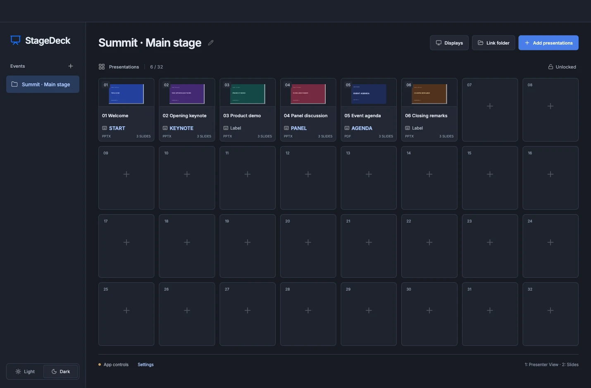
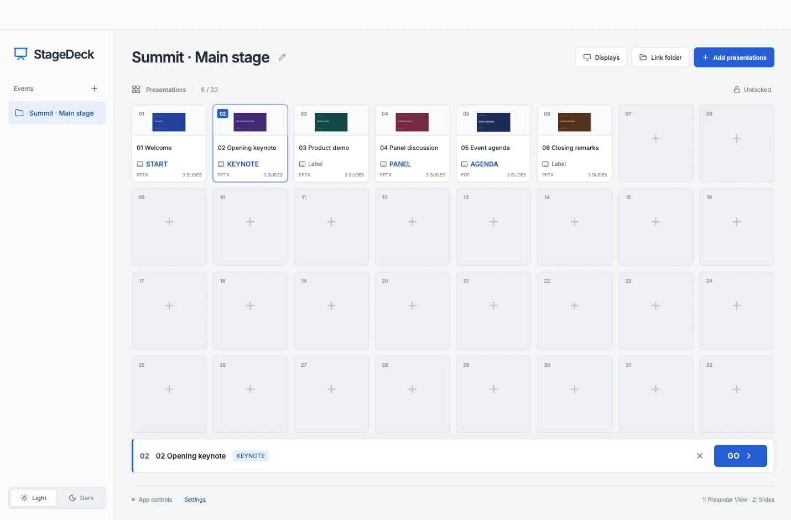
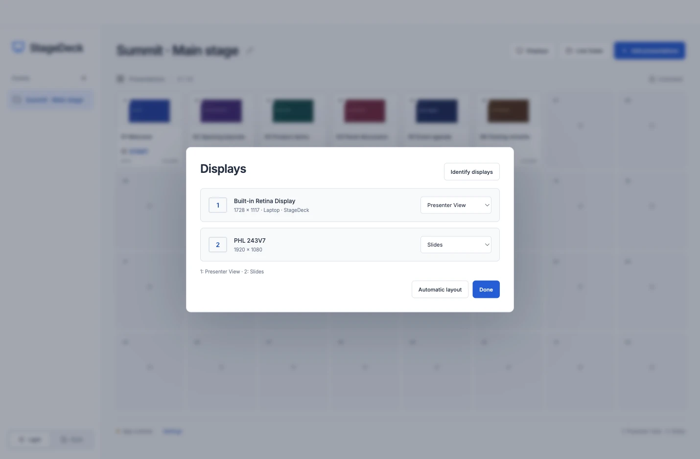
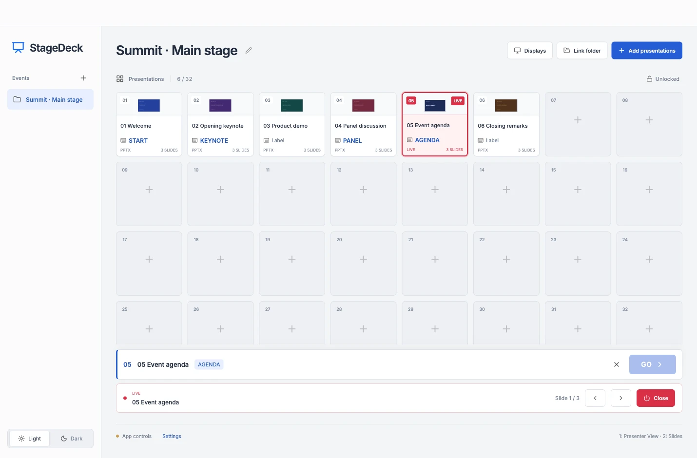
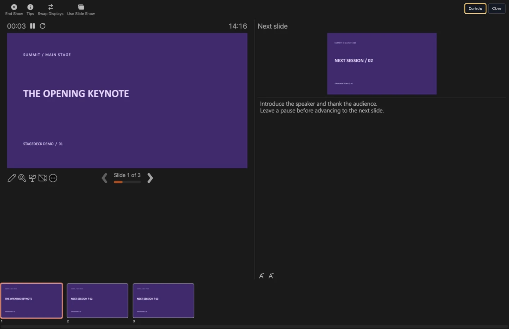
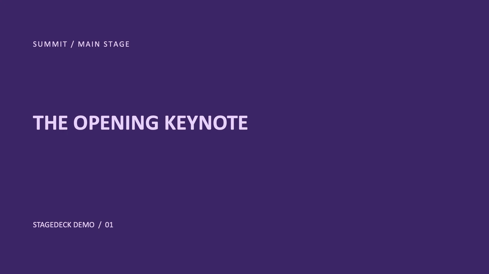
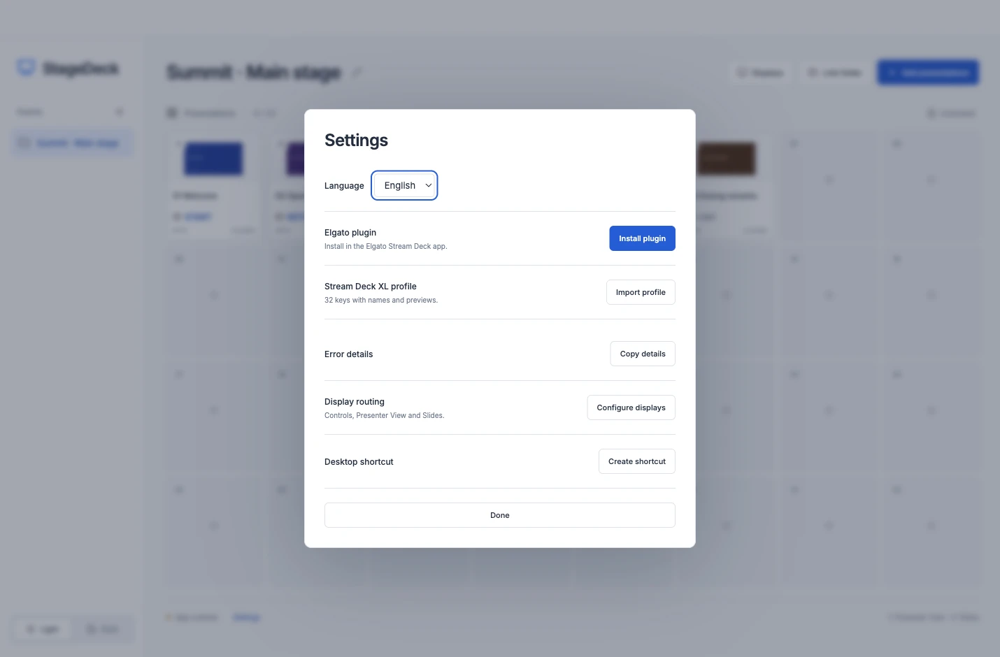
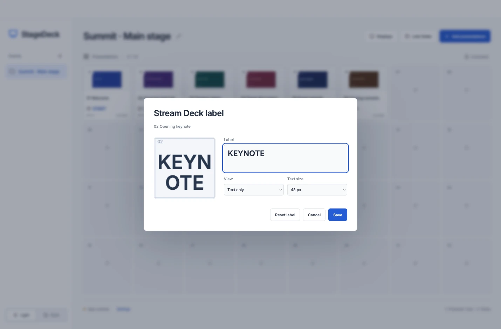
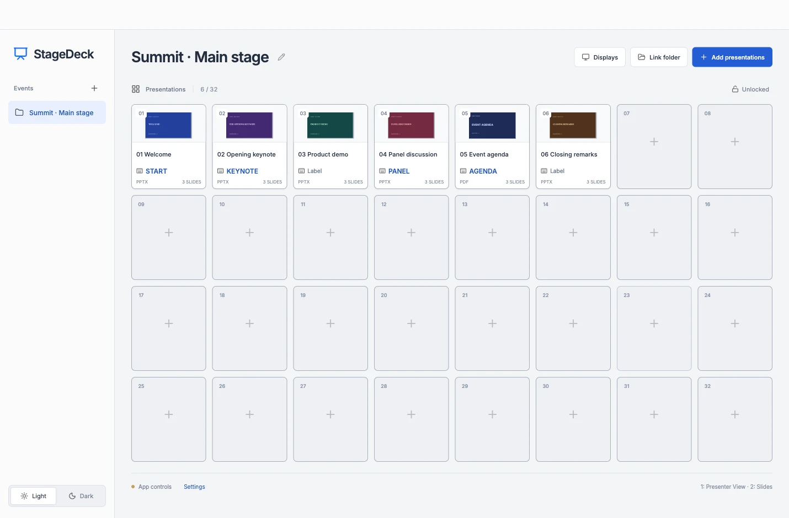
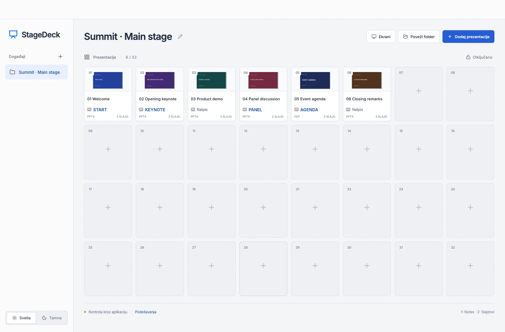

# StageDeck — PowerPoint and PDF presentation launcher for Stream Deck XL

StageDeck is a desktop presentation cue desk for Windows and macOS. Load a run
of PowerPoint and PDF files before the event, give each presentation a key, and
start the right file without searching through folders in front of the audience.
Use it with an Elgato Stream Deck XL or run the whole show with your mouse.

[**Download for Windows**](https://github.com/srdjankotarlic/stagedeck/releases/latest/download/StageDeck-Windows.zip) ·
[**Download for Mac**](https://github.com/srdjankotarlic/stagedeck/releases/latest/download/StageDeck-Mac.zip) ·
[Website](https://srdjankotarlic.github.io/stagedeck/) ·
[Installation guide](INSTALL.md) · [Uputstvo na srpskom](INSTALL-SR.md)

## Run the show

1. **Load your event.** Drag PowerPoint or PDF files into the 32-slot grid, or
   link a folder to pick up new files. StageDeck uses the filename and generates
   a preview where available. Drag slots to reorder them; lock the layout when
   you're ready. Keep separate events for different rooms or shows.
2. **Assign displays.** Identify up to three connected displays. For each one,
   choose **Controls only**, **Presenter View** for PowerPoint notes, or
   **Slides** for the audience. The same output can appear on multiple displays.
   PDF playback uses the Slides assignments and needs no Office installation.
3. **Cue and go.** Click a thumbnail to select it, then press **GO**. Clicking
   or double-clicking a card alone won't put it live. Use the slide controls
   to navigate and **Close** to clear the show. The active slot is marked red.
4. **Or press a Stream Deck key.** The first press opens the presentation; the
   second closes it and its output. StageDeck does not close other PowerPoint
   documents. Live keys turn red.

| Click a cue, then press GO | Assign presenter notes and audience slides |
| --- | --- |
|  |  |
| **Live status and navigation** | **Fullscreen PDF output** |
|  |  |

| PowerPoint Presenter View | Fullscreen PowerPoint audience output |
| --- | --- |
|  |  |

## Set up Elgato Stream Deck XL

1. Install the Elgato Stream Deck desktop app. Open StageDeck's **Settings** and
   choose **Install plugin**. Approve the install in Elgato.
2. Select the bundled **StageDeck XL** profile. If it doesn't appear, use
   **Import profile** in StageDeck. The profile maps all 32 physical positions.
3. In StageDeck, click the keyboard icon on a card to set a short key label,
   such as `KEYNOTE` or `N23`, without changing the presentation's full name.
   Choose **Text only** for large labels or **Image + text** for a slide preview
   with the label. The editor shows what will appear on the key.
4. Keep both desktop apps running. Press a key to start, look for its red
   **LIVE** state, and press it again to end that presentation.

| Plugin and XL profile setup | Edit a key without renaming the presentation |
| --- | --- |
|  |  |

## Language and appearance

English is the default. Switch to Serbian (Latin script) under
**Settings → Language**. A new installation starts in dark mode; choose **Light**
in the sidebar if you prefer it. StageDeck saves both choices. Presentation
names, key labels, folder links, and display assignments stay as entered.

| Light theme | Serbian interface |
| --- | --- |
|  |  |

## Requirements and downloads

| | Requirements | Installation |
| --- | --- | --- |
| **Windows** | Windows 10/11 x64 | Extract the ZIP, run `Install-StageDeck.cmd` for the app and plugin, or run `StageDeck-Setup.exe` to install the app manually. |
| **macOS** | macOS 13 or later, Intel or Apple Silicon | Extract the ZIP, open `StageDeck.dmg`, then drag the app into Applications. See the [Mac permissions and installation notes](INSTALL.md). |
| **PowerPoint** | Microsoft PowerPoint desktop app | PowerPoint renders the original slides and Presenter View. PDFs play without Office. |
| **Stream Deck XL** | Optional; Elgato Stream Deck 6.6 or later | Both downloads include the plugin and XL profile. |

StageDeck and the plugin work locally, without an account. Check your exact
Office build, monitor arrangement, and presentations before going on air.
See the [verification notes](docs/VERIFICATION.md) for tested configurations,
the [release history](https://github.com/srdjankotarlic/stagedeck/releases) for
previous installers, and the [developer guide](docs/DEVELOPMENT.md) for source
and build instructions.

[Report an issue](https://github.com/srdjankotarlic/stagedeck/issues/new) ·
[MIT license](LICENSE). StageDeck is an independent project and is not affiliated
with Microsoft or Elgato.
